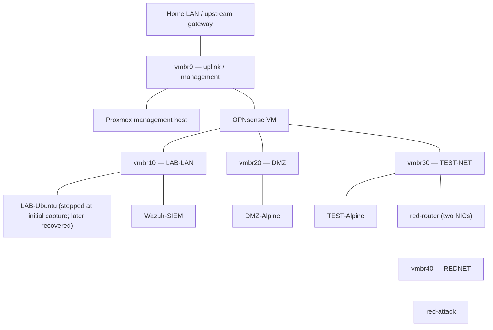

# 01 — Enterprise Security Architecture

**Project type:** Independent cybersecurity homelab  
**Status:** Current-state documentation in progress — initial inventory captured on 2026-11-18; subsequent availability recovery recorded  
**Technology:** Proxmox VE, OPNsense, Linux

## Executive summary

This project documents the design and operation of a segmented virtual laboratory used to explore enterprise network security, firewall policy, infrastructure operations, and security monitoring. The emphasis is on explaining architectural decisions and risk tradeoffs as well as demonstrating technical implementation.

## Business and security objectives

- Separate internal administration, test services, and security monitoring workloads.
- Control and document traffic between network segments.
- Centralize relevant security telemetry for investigation.
- Maintain a repeatable approach to change management, validation, and recovery.

## Verified virtualization baseline (2026-11-18)

Source: administrator-supplied output from `pveversion`, `qm list`, `pvesh ... network`, and `free -h`. Details below are intentionally generalized for public publication.

- **Hypervisor:** Proxmox VE 9.1.1, kernel 6.17.2-1-pve.
- **Host memory:** 31 GiB reported; 14 GiB used and approximately 17 GiB available at collection; 8 GiB swap configured, none in use.
- **Virtual machines:** Seven configured; six running at capture time.
- **Running roles inferred from VM names:** OPNsense firewall (2 GiB allocated), two Alpine test endpoints (512 MiB each), a red-team router (1 GiB), a red-team test endpoint (512 MiB), and a Wazuh SIEM (8 GiB).
- **At initial capture:** One Ubuntu lab VM was stopped (2 GiB allocated). **Subsequent update:** The VM was restarted successfully following a storage-availability incident; SSH jump-host access was restored. See [incident case study](storage-availability-incident.md).
- **Virtual bridges:** Five active bridges: one host-addressed bridge and four without host IP addresses shown. Physical uplink binding, VM network attachments, and firewall enforcement remain unverified.
- **Capacity caution:** RAM allocation is not a measure of guest utilization. No claims are made about the SIEM being fully operational based on VM power status alone.

## Previously used lab network segments

| Segment | Lab subnet | Intended purpose |
| --- | --- | --- |
| LAN | `10.10.10.0/24` | Internal systems and administration |
| DMZ | `10.10.20.0/24` | Isolated test services |
| SOC | `10.10.30.0/24` | Security monitoring |

**Verification pending:** These subnets reflect earlier lab exercises; bridge names and attached systems have been verified, but active guest addressing, routing, firewall rules, and workloads still require validation. TEST-NET is not currently confirmed as a dedicated SOC segment. Public diagrams will use illustrative addresses or redacted details.

## Architecture inventory — to be verified

| Component | Function | Evidence required |
| --- | --- | --- |
| Proxmox VE | Verified host and virtual bridges | VM-to-bridge mapping and physical uplink binding |
| OPNsense | Running VM; security enforcement not yet verified | Sanitized interface and rule summaries |
| Linux server(s) | Internal services and log reception | Sanitized service inventory |
| DMZ workload(s) | Controlled test systems | Sanitized network and service descriptions |
| Security monitoring | Wazuh SIEM VM running; ingestion not verified | Data-flow description and alert examples |

## Verified virtual network topology (2026-11-18)

The topology below is based on the Proxmox VM NIC assignments and `/etc/network/interfaces`. It shows **Layer 2 connections**, not verified firewall allow/deny behavior. Specific VM MAC addresses and the real host management address are intentionally omitted.

### Verified bridge mappings

| Segment | Bridge | Connected VMs / interfaces | Physical uplink |
| --- | --- | --- | --- |
| Home uplink / management | `vmbr0` | Proxmox host, OPNsense net0 | `nic0` |
| LAB-LAN | `vmbr10` | OPNsense net1, LAB-Ubuntu net0, Wazuh-SIEM net0 | None |
| DMZ | `vmbr20` | OPNsense net2, DMZ-Alpine net0 | None |
| TEST-NET | `vmbr30` | OPNsense net3, TEST-Alpine net0, red-router net0 | None |
| REDNET | `vmbr40` | red-router net1, red-attack net0 | None |

### Important architecture observations

- The Proxmox management interface and OPNsense upstream/WAN-facing NIC share `vmbr0`, which connects to the home network. Management-plane hardening and exposure require review.
- `vmbr10`, `vmbr20`, `vmbr30`, and `vmbr40` have no physical bridge ports configured. This confirms no direct physical uplinks in the base network file; logical forwarding via the connected routers remains possible.
- Wazuh-SIEM is attached to LAB-LAN (`vmbr10`), **not** a separate SOC bridge. Do not represent TEST-NET as a dedicated SOC network without additional evidence.
- `red-router` is dual-homed between TEST-NET and REDNET. Its forwarding/NAT/firewall configuration must be inspected before claiming REDNET is isolated from other networks.
- Proxmox VM NIC settings include `firewall=1` for LAB-Ubuntu, TEST-Alpine, red-attack, and Wazuh-SIEM. This is an interface-level setting, **not proof** that Proxmox firewall enforcement is enabled or effective.
- OPNsense DMZ and TEST-NET interface assignments and one explicit logged cross-zone block policy have been verified; complete inter-zone policy coverage remains under review.
- Device names such as REDNET and DMZ identify intended lab roles, not validated trust boundaries.

### Verified segmentation control (2026-11-19 local)

The OPNsense DMZ and TEST-NET virtual interfaces were confirmed active. An existing logged firewall rule blocked a controlled TCP/22 attempt from a DMZ endpoint toward TEST-NET. Three blocked SYN retries were present in centralized firewall logs, and Wazuh generated matching level-5 alerts through rule 100104. This validates **one specific zone-to-zone denied flow**, not the totality of the network isolation design. See [Project 02 — Network detection evidence](../02-security-operations/README.md#verified-network-segmentation-and-siem-detection-2026-11-19-local).

### Next validation steps

- [x] Map VM NICs to Proxmox bridges.
- [x] Verify bridge port definitions.
- [ ] Confirm OPNsense interface assignment, routing, and inter-zone policies.
- [ ] Inspect red-router IP forwarding, NAT, and filtering without publishing live sensitive rules.
- [ ] Verify host and Proxmox guest firewall enablement and rule scope.
- [x] Record one tested DMZ-to-TEST-NET denied SSH flow with firewall and Wazuh evidence.
- [ ] Validate additional inter-zone allow and deny flows.
- [ ] Review Proxmox management-plane access from the home network.

## Security design and risk decisions

_To be completed after the current-state assessment._

- **Trust boundaries:** Which systems can initiate connections across segments?
- **Least privilege:** Which network flows are explicitly permitted, and why?
- **Logging:** What is collected, retained, and reviewed?
- **Recovery:** How are configuration changes tested and reversed?
- **Residual risk:** What limitations remain due to hardware, architecture, or lab scope?

## Evidence and validation plan

- [x] Capture initial sanitized Proxmox VM inventory and active bridge list.
- [x] Verify VM-to-bridge attachments, NIC uplinks, and the base bridge configuration.
- [ ] Confirm current OPNsense interfaces and security zones.
- [ ] Document permitted and denied inter-segment flows.
- [ ] Create an accurate, sanitized architecture diagram.
- [x] Validate one DMZ-to-TEST-NET SSH block with controlled test and correlated SIEM evidence.
- [ ] Extend segmentation validation to additional protocols and zones.
- [ ] Document at least three risks and their mitigations.
- [ ] Write a one-page executive summary of findings and next steps.

## Portfolio integrity and safety

All exercises take place on personally owned or explicitly authorized infrastructure. Published artifacts will exclude passwords, tokens, real identifying information, sensitive configuration details, and any military operational data. Planned capabilities will not be represented as implemented until verified.

## Incident response and resilience case study

A later SSD storage outage interrupted the administrative jump-host workflow. Diagnostics, recovery actions, verified outcomes, and remaining risks are documented in the [Storage Availability Incident Case Study](storage-availability-incident.md). This case reinforces the distinction between network security controls and operational resilience.

## Lessons learned

- Single points of failure in management access can constrain incident response even when the segmented virtual network remains intact.
- A SMART health result of PASSED does not establish that an intermittently inaccessible disk or SATA connection is reliable.
- Backups and alternate management access should be treated as documented controls, with restore tests and ownership, rather than assumed capabilities.
