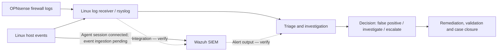

# 02 — Security Operations & Monitoring

**Project type:** Independent cybersecurity lab | **Status:** Documenting and validating current-state capabilities  
**Core technologies:** Wazuh, rsyslog, Linux, OPNsense, Proxmox VE, packet capture

## Executive overview

This project develops a practical security-operations workflow for a segmented virtual lab: collect relevant telemetry, assess suspicious activity, investigate with repeatable procedures, and communicate findings and remediation decisions. The emphasis is on operational ownership, evidence quality, and risk-based response, not simply installing security tools.

**Integrity note:** Earlier lab exercises established remote syslog reception, firewall log review, host monitoring scripts, and packet capture workflows. A Wazuh SIEM virtual machine is present in the current Proxmox inventory; agent connectivity has now been verified; endpoint security-alert generation has now been verified; dashboard indexing, custom test-event matching, and data retention have **not yet been validated** for this publication. No fictional alerts, detection rates, or response-time improvements are claimed.

## Operational objectives

1. Establish repeatable ingestion and retention of firewall and Linux security events.
2. Connect telemetry sources to a documented inventory and identify coverage gaps.
3. Define triage, escalation, containment, recovery, and closure procedures.
4. Demonstrate one authorized investigation with sanitized, reproducible evidence.
5. Measure monitoring reliability and document operational dependencies.

## Known environment and evidence status

| Component | Intended/previously exercised function | Current evidence status |
| --- | --- | --- |
| OPNsense | Zone routing and firewall logs | VM and bridge assignments verified; current rules and forwarded log coverage pending |
| Linux log server | Receive remote syslog, organize events, support analysis | Previously configured and tested in lab; service health, ingestion, and retention require fresh verification |
| Wazuh SIEM | Centralized security analytics, endpoint monitoring | SSH-accessible manager; TCP 1514 and 1515 reachable from Ubuntu; two agents active. Manager's alerts.json includes LAB-Ubuntu sudo and PAM events, establishing ingestion, rule matching, and alert file output. Dashboard indexing unverified |
| Linux endpoints | System events and security telemetry | Agent enrollment, sources, and coverage pending |
| Capture workflow | Collect selected network packet evidence | Earlier lab workflow described; capture and chain of custody demonstration pending |

The Wazuh VM is connected to the internal lab network, not a physically separate SOC management network. The topology is described in [Project 01](../01-security-architecture/README.md).

## Proposed monitoring data flow

Solid lines reflect previously exercised workflows or proposed human-process steps; dashed lines are **not yet confirmed as functioning** in the current environment.

## Connectivity validation evidence (2026-11-18 local time)

Operator-supplied command results, sanitized for publication:

- The LAB-Ubuntu Wazuh agent service was reported **active** by systemd.
- The agent log recorded repeated failures reaching the manager over TCP 1514 and the enrollment endpoint over TCP 1515, followed by a successful TCP 1514 connection at 19:04:42 local log time.
- A later `nc` test from LAB-Ubuntu succeeded to the manager on **TCP 1514** and **TCP 1515**.
- SSH to the Wazuh manager succeeded.
- On the manager, `agent_control -l` reported **LAB-Ubuntu** and **OPNsense** as **Active**, with the manager's local entry also Active/Local.

**Additional ingestion evidence:** The manager's `alerts.json` contained recent agent 001 (`LAB-Ubuntu`) events for Wazuh rules **5402** (successful sudo to root), **5501** (PAM session opened), and **5502** (PAM session closed), collected from `journald`. This verifies that LAB-Ubuntu security telemetry is ingested, decoded, matched to built-in rules, and written to local alert output. A manual grep for `SOC-VALIDATION` returned no alert matches; it remains unverified whether that test event was generated, collected, or filtered below the alert threshold.

**Limitations:** Local alert output does not establish dashboard indexing, complete source coverage, detection efficacy, or service uptime. Earlier connection failures may reflect startup sequencing after the infrastructure outage, but that cause is not proven.

## Investigation workflow

| Stage | Analyst/lead action | Required evidence |
| --- | --- | --- |
| 1. Intake | Record alert, observation, scope and detection time | Source, timestamp and host identity |
| 2. Validation | Compare relevant firewall, host and service events | Sanitized log excerpts and timezone |
| 3. Triage | Determine affected assets and plausible impact | Asset context and severity rationale |
| 4. Containment | Select least-disruptive authorized control | Decision owner, change record, rollback |
| 5. Recovery | Restore service and confirm expected behavior | Service checks and network validation |
| 6. Closure | Document contributing factors, gaps and follow-up | Timeline, lessons and assigned actions |

**Example severity decision:** A failed SSH attempt on a lab test account is not by itself a confirmed compromise. Escalation requires corroborating context such as repeated unauthorized attempts, unexpected source, successful access, or other host evidence.

## Operational metrics to establish

| Measure | Definition | Baseline |
| --- | --- | --- |
| Log source coverage | Verified reporting sources ÷ in-scope sources | Not measured |
| Ingestion delay | Event occurrence to log availability | Not measured |
| Alert precision | Confirmed actionable alerts ÷ alerts reviewed | Not measured |
| Mean time to acknowledge | First detection to analyst acknowledgement | Not measured |
| Recovery verification | Cases with recorded restoration checks ÷ recovery cases | Not measured |
| Collection availability | Time the log collection path accepts test events | Not measured |

No performance claims will be published until measured in a reproducible test.

## Current priorities and validation checklist

- [ ] Confirm OPNsense log forwarding destination and enabled event categories.
- [ ] Validate Linux receiver with a uniquely tagged test event and corresponding stored log.
- [ ] Verify log rotation, available disk space and file permissions.
- [x] Verify Wazuh manager is accessible and registered LAB-Ubuntu and OPNsense agents report **Active** (2026-11-18 local / 2026-11-19 UTC).
- [x] Verify LAB-Ubuntu authentication and sudo events reach the manager and generate alerts in `alerts.json`.
- [ ] Confirm Wazuh dashboard indexing and searching; test a unique custom event (not yet present in alerts.json).
- [ ] Produce one authorized test case, with timestamps and sanitized evidence.
- [ ] Document triage decision, owner, containment criteria and rollback.
- [ ] Identify single points of failure and recovery dependencies.
- [ ] Publish a concise SOC operations review and lessons learned.

## Management perspective

A security monitoring deployment is not operationally effective solely because a dashboard or VM exists. Leadership must account for source coverage, alert quality, analyst workflow, ownership, retention, evidence handling, recovery and the cost of maintaining the service.

A recent laboratory storage interruption reinforces that monitoring and management systems themselves require backup, recovery validation, and continuity planning. See the [Storage Availability Incident Case Study](../01-security-architecture/storage-availability-incident.md).

## Publication safeguards

All examples are from authorized lab activity. Exclude personal IP addresses, MAC addresses, private hostnames, credentials, secrets, raw logs identifying home systems, and any military operational information. Mark simulated events explicitly and distinguish observed results from planned capabilities.
