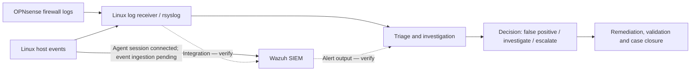

# 02 — Security Operations & Monitoring

**Project type:** Independent cybersecurity lab | **Status:** Documenting and validating current-state capabilities  
**Core technologies:** Wazuh, rsyslog, Linux, OPNsense, Proxmox VE, packet capture

## Executive overview

This project develops a practical security-operations workflow for a segmented virtual lab: collect relevant telemetry, assess suspicious activity, investigate with repeatable procedures, and communicate findings and remediation decisions. The emphasis is on operational ownership, evidence quality, and risk-based response, not simply installing security tools.

**Integrity note:** Earlier lab exercises established remote syslog reception, firewall log review, host monitoring scripts, and packet capture workflows. A Wazuh SIEM virtual machine is present in the current Proxmox inventory; agent connectivity has now been verified; endpoint security-alert generation has now been verified; dashboard indexing for the validated firewall alerts has been confirmed; full coverage and data retention have **not yet been validated**. No fictional alerts, detection rates, or response-time improvements are claimed.

## Executive assessment and improvement roadmap

The [SOC Operational Effectiveness — Executive Assessment](soc-operational-effectiveness-review.md) consolidates validated security controls, readiness gaps, a prioritized risk register, proposed governance and KPIs, and a 30/60/90-day improvement plan. It distinguishes live evidence from offline tests and planned capabilities.

## Operational objectives

1. Establish repeatable ingestion and retention of firewall and Linux security events.
2. Connect telemetry sources to a documented inventory and identify coverage gaps.
3. Define triage, escalation, containment, recovery, and closure procedures.
4. Demonstrate one authorized investigation with sanitized, reproducible evidence.
5. Measure monitoring reliability and document operational dependencies.

## Known environment and evidence status

| Component | Intended/previously exercised function | Current evidence status |
| --- | --- | --- |
| OPNsense | Zone routing and firewall logs | VM and bridge assignments verified; current rules and forwarded log coverage pending |
| Linux log server | Receive remote syslog, organize events, support analysis | Previously configured and tested in lab; service health, ingestion, and retention require fresh verification |
| Wazuh SIEM | Centralized security analytics, endpoint monitoring | SSH-accessible manager; TCP 1514 and 1515 reachable from Ubuntu; two agents active. Manager's alerts.json includes LAB-Ubuntu sudo and PAM events, establishing ingestion, rule matching, and alert file output. Dashboard indexing unverified |
| Linux endpoints | System events and security telemetry | Agent enrollment, sources, and coverage pending |
| Capture workflow | Collect selected network packet evidence | Earlier lab workflow described; capture and chain of custody demonstration pending |

The Wazuh VM is connected to the internal lab network, not a physically separate SOC management network. The topology is described in [Project 01](../01-security-architecture/README.md).

## Proposed monitoring data flow



Solid lines reflect previously exercised workflows or proposed human-process steps; dashed lines are **not yet confirmed as functioning** in the current environment.

## Connectivity validation evidence (2026-11-18 local time)

Operator-supplied command results, sanitized for publication:

- The LAB-Ubuntu Wazuh agent service was reported **active** by systemd.
- The agent log recorded repeated failures reaching the manager over TCP 1514 and the enrollment endpoint over TCP 1515, followed by a successful TCP 1514 connection at 19:04:42 local log time.
- A later `nc` test from LAB-Ubuntu succeeded to the manager on **TCP 1514** and **TCP 1515**.
- SSH to the Wazuh manager succeeded.
- On the manager, `agent_control -l` reported **LAB-Ubuntu** and **OPNsense** as **Active**, with the manager's local entry also Active/Local.

**Additional ingestion evidence:** The manager's `alerts.json` contained recent agent 001 (`LAB-Ubuntu`) events for Wazuh rules **5402** (successful sudo to root), **5501** (PAM session opened), and **5502** (PAM session closed), collected from `journald`. This verifies that LAB-Ubuntu security telemetry is ingested, decoded, matched to built-in rules, and written to local alert output. A manual grep for `SOC-VALIDATION` returned no alert matches. Subsequent source verification confirmed two `SOC-VALIDATION` records in LAB-Ubuntu's local journal at 19:18:00 and 19:20:07 on November 18 (local time). Forwarding and alert matching for these custom events remain unverified.

**Limitations:** Local alert output does not establish dashboard indexing, complete source coverage, detection efficacy, or service uptime. Earlier connection failures may reflect startup sequencing after the infrastructure outage, but that cause is not proven.

## Custom SOC detection rule — offline test verified

**Validation state:** Wazuh `wazuh-logtest` succeeded against custom rule **100108**, level **5**, on November 18, 2026 local time. The initial candidate ID conflicted with existing rules; a unique ID was used instead. Existing reverse-shell detection (rule 100100) was preserved.

Test event:

```text
Nov 18 19:20:07 labserver SOC-VALIDATION[6514]: Authorized SOC telemetry validation
```

Observed test output:

- Phase 1 extracted `program_name: SOC-VALIDATION`, timestamp, and host.
- Phase 2: `No decoder matched`. This did not prevent rule evaluation against the pre-decoded program name.
- Phase 3 selected rule **100108**, level **5**, description **Authorized SOC validation event detected**, with **Alert to be generated**.

**Live end-to-end validation: VERIFIED.** After the offline rule test, a fresh LAB-Ubuntu event was received and recorded as a level-5 alert by the manager. This demonstrates the event path from Ubuntu journal via Wazuh agent to manager rule matching and local alert output. Dashboard search/indexing, overall detection coverage, and sustained collection remain unverified.

## End-to-end detection evidence — verified November 18, 2026 (local)

A fresh authorized test event from LAB-Ubuntu generated the following observed manager-side alert (sensitive host IP details omitted):

| Field | Observed result |
| --- | --- |
| Source agent | `001` — LAB-Ubuntu |
| Collection location | `journald` |
| Pre-decoded program | `SOC-VALIDATION` |
| Event payload | `Authorized SOC telemetry validation` |
| Rule matched | `100108` |
| Alert description | `Authorized SOC validation event detected` |
| Alert level | `5` |
| Event timestamp | `2026-11-19 03:34:04 UTC` (syslog precision: 1 second) |
| Manager alert timestamp | `2026-11-19 03:34:05.752 UTC` |
| Alert output | `/var/ossec/logs/alerts/alerts.json` |
| Outcome | **PASS — local manager alert generated from live endpoint event** |

**Observed path:** Source system journal → enrolled Wazuh agent → Wazuh manager → custom rule 100108 → `alerts.json`.

**Measurement caveat:** The source event timestamp has one-second precision, so the apparent ~1.75-second difference is illustrative, not a validated end-to-end latency SLA. This one successful event does not establish detection coverage, retention or sustained availability.

## Verified network segmentation and SIEM detection (2026-11-19 local)

**Test:** An authorized DMZ test endpoint attempted TCP SSH access to a TEST-NET endpoint. OPNsense enforced an explicit logged block on its DMZ interface and relayed three dropped TCP SYN events to the Linux log receiver. Wazuh's LAB-Ubuntu agent collected the restricted firewall log and the manager generated three level-5 alerts using existing rule **100104**.

| Evidence | Observed result |
| --- | --- |
| Origin zone | DMZ / OPNsense `vtnet2` |
| Destination zone | TEST-NET |
| Attempt | TCP port 22 (SSH); one connection attempt |
| Firewall action | `block,in`, with three observed SYN retries |
| Firewall rule | Existing explicit logged DMZ-to-TEST-NET block |
| Collection path | OPNsense `filterlog` → remote rsyslog file → LAB-Ubuntu Wazuh agent |
| Wazuh decoder | `pf` |
| Wazuh matched rule | `100104`, description: firewall blocked TCP |
| Alert level | 5 |
| Manager evidence | Three records in `alerts.json`, source agent `001` (LAB-Ubuntu) |
| Result | **PASS:** enforced block, remote log reception, endpoint collection, parsing, rule match and alert generation verified |

**Scope and caveats:** This proves the specified lab-zone traffic block for the tested flow, not universal isolation across all ports, routes, or zones. Three packet alerts represent retries of a single connection attempt; they are not evidence of three independent attacks. The Wazuh agent restricts firewall log collection to blocked events on `vtnet2` and `vtnet3`; substantial upstream/WAN background traffic is intentionally excluded. The OPNsense manager-side agent was separately reported active, but this specific firewall test was collected and attributed to the **LAB-Ubuntu agent**, not directly to the OPNsense agent.

**Next validation:** Offline rule escalation verified for `100105` and `100106`; validate nonmatching/negative scenarios, live repeated attempts under controlled conditions, dashboard indexing, and log retention.

## Multi-stage firewall alert escalation — offline validation

**Test date:** 2026-11-19 (lab local)  
**Method:** `wazuh-logtest` with synthetic OPNsense `filterlog` entries; this is **not** a live network escalation test.

A simulated DMZ source made blocked TCP connection attempts to a protected management destination on TCP/4444. The existing `pf` decoder extracted `action=block`, `protocol=tcp`, source and destination addresses and destination port.

| Rule | Function | Level | Evidence |
| --- | --- | --- | --- |
| `100104` | General blocked TCP packet | 5 | Previously verified with live DMZ-to-TEST-NET events |
| `100105` | Blocked access to protected Wazuh management endpoint on configured ports | 10 | Offline logtest matched the synthetic management-access event |
| `100106` | Correlation of repeated `100105` events sharing source and destination over a 60-second threshold | 12 | Offline logtest reported rule `100106`, `frequency: 5`, and `Alert to be generated` |

The offline sequence produced two level-12 correlation outcomes, demonstrating rule matching and stateful escalation in the test session. The pasted output also included repeated synthetic entries; therefore this run **does not establish** whether five distinct live connection attempts reliably produce a correlation alert. `mail: True` was displayed in logtest; email delivery was not verified.

### Negative correlation test — different source addresses

**Method:** A fresh `wazuh-logtest` session with five synthetic blocked management-access events targeting the same protected destination, split as three events from one DMZ source and two from a different DMZ source. The initial attempt contained a malformed timestamp and was excluded; the operator reran the corrected test.

**Reported result:** The operator confirmed the corrected test generated **no rule 100106 escalation**. The qualifying events were designed to match the lower-severity management-access rule 100105, while neither source independently reached the five-event threshold.

**Conclusion:** This negative test supports source-IP-specific correlation and reduces risk of aggregating unrelated sources into a high-severity event. It is an **offline test**, not a live event or quantified false-positive rate. A separate negative test using differing destinations remains pending.

### Negative hierarchy test — alternate destination

**Method:** A fresh offline `wazuh-logtest` session received five synthetic blocked TCP events from the same source: three addressed to the configured Wazuh management IP, followed by two addressed to a different lab IP. All five decoded with the `pf` decoder.

| Events | Destination category | Expected rule | Observed |
| --- | --- | --- | --- |
| 1–3 | Configured Wazuh management destination | `100105` / level 10 | All three matched `100105` / level 10 |
| 4–5 | Alternate lab destination | `100104` / level 5 | Both matched `100104` / level 5 |

**Result: PASS.** No level-12 `100106` outcome was reported. The two alternate-destination events were not eligible for correlation because prerequisite rule `100105` constrains the destination to the Wazuh management server. Thus the test validates destination-specific rule hierarchy and lack of erroneous escalation **but does not independently validate** the `<same_dstip />` correlation operator. Proving that operator requires a test-only prerequisite capable of matching multiple destination addresses.

This was offline synthetic telemetry; no live management access, production alert, outbound email notification, or real-world false-positive rate was demonstrated.

**Operational limitations:** No real traffic to the management server was generated for this correlation test; event deduplication, false positive rate, downstream notification, indexing, and real-world escalation timing remain unmeasured.

**Planned improvements:** Repeat with uniquely generated events in a fresh test session, confirm alert behavior for below-threshold and nonmatching source/destination scenarios, and conduct a narrowly scoped live validation only after confirming firewall protections.

## Searchable Wazuh dashboard alert evidence (2026-11-20)

The lab operator verified that all **three previously confirmed live OPNsense firewall alerts** are searchable in the Wazuh dashboard (rule `100104`, level 5, source agent `LAB-Ubuntu`). A dashboard screenshot showed **3 hits** for the November 19 firewall test, with the expected alert description and rule metadata. This validates the path from blocked test traffic through OPNsense, remote rsyslog, Wazuh agent and manager, indexed alert storage, and dashboard retrieval.

**Caveat:** The three results represent blocked TCP SYN retries during one controlled connection attempt, not three incidents. Successful retrieval of these records does not establish an indexing reliability SLA, retention duration, storage capacity, complete event coverage, or alert response effectiveness.

## Remote syslog rotation incident — remediation validated (2026-11-20)

The Linux log receiver's scheduled `logrotate.service` failed on November 19 and at 00:23 local on November 20 with repeated `Permission denied` errors when attempting to rotate remote logs. The remote-syslog policy used an execution identity that lacked consistent access to the log files, which were split between `labadmin:labadmin` and `syslog:adm`.

A corrected, fresh audit executed under the `syslog:adm` identity verified read/write access to **92 non-OPNsense active logs** and write/traverse access to the five relevant log directories. Following a targeted change to the remote-syslog rotation identity, the operator verified:

- `logrotate.service` finished successfully at **17:03 local**, November 20, reporting `Result=success` and `ExecMainStatus=0`.
- The OPNsense firewall's active remote log remained writable and contained fresh events at **17:04 local** after the rotation.
- No broad `chmod` or recursive ownership change was necessary.

**Status:** Successful logrotate execution and continued **firewall-to-rsyslog delivery** verified. **Follow-up reported:** The operator confirmed the controlled post-rotation DMZ-to-TEST-NET blocked-traffic and corresponding Wazuh rule-100104 checks looked good. Exact new log excerpts/timestamps were not supplied, so record this as **operator-reported verification**, distinct from the earlier directly observed alerts. **Still open:** repeated scheduled-run reliability, actual retention duration, and indexer lifecycle policy. Long-term scheduled reliability, accurate retention duration, and indexer lifecycle have not yet been measured.

## Investigation workflow

| Stage | Analyst/lead action | Required evidence |
| --- | --- | --- |
| 1. Intake | Record alert, observation, scope and detection time | Source, timestamp and host identity |
| 2. Validation | Compare relevant firewall, host and service events | Sanitized log excerpts and timezone |
| 3. Triage | Determine affected assets and plausible impact | Asset context and severity rationale |
| 4. Containment | Select least-disruptive authorized control | Decision owner, change record, rollback |
| 5. Recovery | Restore service and confirm expected behavior | Service checks and network validation |
| 6. Closure | Document contributing factors, gaps and follow-up | Timeline, lessons and assigned actions |

**Example severity decision:** A failed SSH attempt on a lab test account is not by itself a confirmed compromise. Escalation requires corroborating context such as repeated unauthorized attempts, unexpected source, successful access, or other host evidence.

## Operational metrics to establish

| Measure | Definition | Baseline |
| --- | --- | --- |
| Log source coverage | Verified reporting sources ÷ in-scope sources | Not measured |
| Ingestion delay | Event occurrence to log availability | Not measured |
| Alert precision | Confirmed actionable alerts ÷ alerts reviewed | Not measured |
| Mean time to acknowledge | First detection to analyst acknowledgement | Not measured |
| Recovery verification | Cases with recorded restoration checks ÷ recovery cases | Not measured |
| Collection availability | Time the log collection path accepts test events | Not measured |

No performance claims will be published until measured in a reproducible test.

## Current priorities and validation checklist

- [x] Verify current OPNsense firewall block-event forwarding to LAB-Ubuntu for a controlled DMZ-to-TEST-NET test; other categories not yet verified.
- [x] Verify remote syslog file received the controlled OPNsense firewall test events.
- [x] Identify remote logrotate access mismatch and verify successful service execution after targeted identity correction (2026-11-20); next scheduled run and post-rotation Wazuh ingestion still pending.
- [ ] Measure actual retention behavior and assess indexer lifecycle/storage.
- [x] Verify Wazuh manager is accessible and registered LAB-Ubuntu and OPNsense agents report **Active** (2026-11-18 local / 2026-11-19 UTC).
- [x] Verify LAB-Ubuntu authentication and sudo events reach the manager and generate alerts in `alerts.json`.
- [x] Verify two uniquely tagged `SOC-VALIDATION` events are present in the source Ubuntu journal.
- [x] Validate rule 100108 using `wazuh-logtest` (offline detection-engine test).
- [x] Generate a new live LAB-Ubuntu event and verify rule 100108 in manager `alerts.json` (confirmed 2026-11-19 03:34 UTC).
- [x] Verify live OPNsense block event ingestion and Wazuh manager alert generation through LAB-Ubuntu (rule 100104).
- [x] Confirm dashboard indexing and searching: three live OPNsense rule-100104 alerts visible in dashboard (2026-11-20).
- [x] Produce one authorized detection test case, with timestamps and sanitized evidence.
- [ ] Document triage decision, owner, containment criteria and rollback.
- [ ] Identify single points of failure and recovery dependencies.
- [x] Publish an executive SOC operational effectiveness review and prioritized 30/60/90-day roadmap (planning assessment; readiness not certified).

## Management perspective

A security monitoring deployment is not operationally effective solely because a dashboard or VM exists. Leadership must account for source coverage, alert quality, analyst workflow, ownership, retention, evidence handling, recovery and the cost of maintaining the service.

A recent laboratory storage interruption reinforces that monitoring and management systems themselves require backup, recovery validation, and continuity planning. See the [Storage Availability Incident Case Study](../01-security-architecture/storage-availability-incident.md).

## Publication safeguards

All examples are from authorized lab activity. Exclude personal IP addresses, MAC addresses, private hostnames, credentials, secrets, raw logs identifying home systems, and any military operational information. Mark simulated events explicitly and distinguish observed results from planned capabilities.

## SIEM disk-capacity detection — validated rule and service activation (2026-11-21 UTC)

To reduce risk of SIEM outage from uncontrolled disk growth, configured root filesystem capacity monitoring using the existing Wazuh Manager `df -P` command collector (360-second interval) and custom rules `100110` (warning at 70–84%, level 7) and `100111` (critical at ≥85%, level 12). Baseline root utilization was 43%; the indexer directory was approximately 33 MB.

Initial rule iterations failed because of duplicate local rule IDs and incorrect Wazuh decoder/parent-rule matching. A cleaned `local_rules.xml` preserved existing SOC detection rules and used the verified Wazuh command-output rule hierarchy. On Wazuh 4.14.9, an **offline synthetic 88% disk reading** triggered rule **100111**, level **12**, with “Alert to be generated.” The final corrected `wazuh:` prefix rules were tested offline at **75% (rule 100110, level 7)**, **88% (rule 100111, level 12)**, and **43% (rule 200, level 0; no disk alert)**. All three expected results were observed.

The manager successfully restarted (`systemctl is-active wazuh-manager`: `active`); no matching error/warning entries appeared in the inspected manager log; and `wazuh-logcollector` reported `Monitoring output of command(360): df -P` at 02:23:55 UTC.

**Status:** Critical rule tested offline and new configuration loaded; **live end-to-end alert delivery at warning/critical thresholds is not verified** (host remains below threshold). The current collector's exact raw event format and ongoing threshold monitoring warrant continued validation. Avoid filling production/lab disks solely to trigger alerts.


### Expansion to LAB-Ubuntu (operator-confirmed, 2026-11-21 UTC)

LAB-Ubuntu agent `001` is active on Wazuh Manager and runs its existing `df -P` command collector every 360 seconds; its root filesystem baseline was 37% utilized. The host-neutral descriptions for centralized rules `100110` (70–84%, level 7) and `100111` (≥85%, level 12) were applied on the manager; the operator reports rule tests looked good and the manager was restarted. Wazuh-SIEM baseline root utilization was 43%. No additional collector was deployed. **Remaining validation:** obtain an actual agent-attributed threshold alert through the live collection/indexing pipeline; no disk-filling test is warranted.
